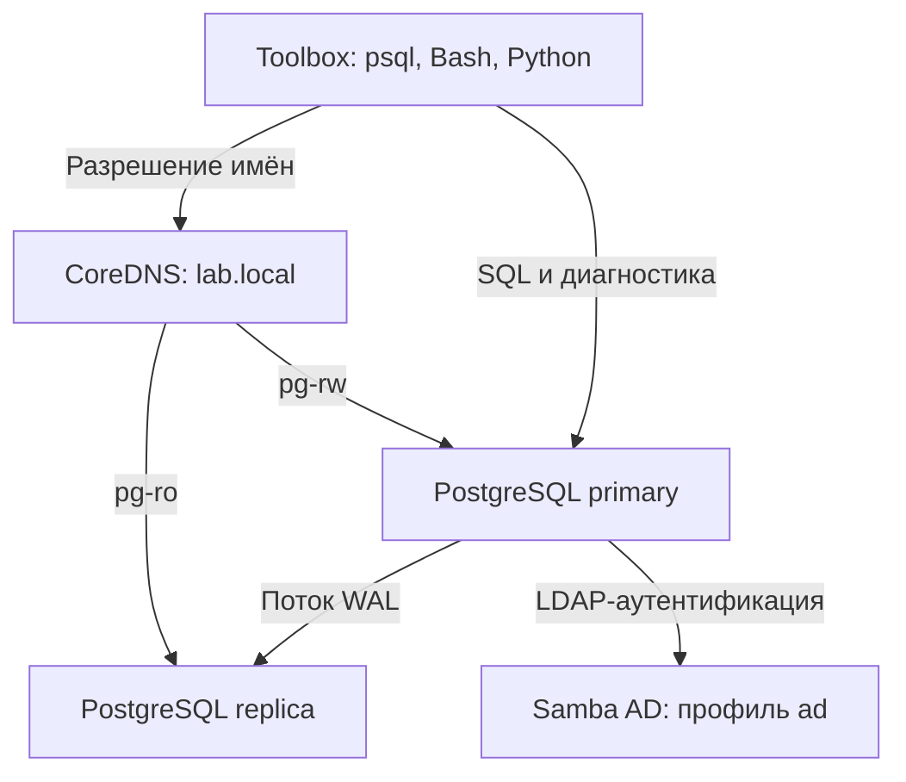

# PG Support Stand — стенд сопровождения PostgreSQL

[](https://github.com/suraginivan-lab/pg-support-stand/actions/workflows/ci.yml)

**Практический проект по администрированию PostgreSQL и автоматизации задач технической поддержки.**

Стенд объединяет PostgreSQL 16, потоковую репликацию, DNS и инструменты диагностики в одном Docker Compose окружении. На примере базы интернет-магазина он позволяет пройти рабочий цикл инженера сопровождения: проверить состояние БД, воспроизвести проблему, найти причину средствами SQL и проверить результат обслуживания или восстановления.

Проект создан как портфолио для позиций **Системного администратора / Junior DBA / инженера технической поддержки**. Основной акцент — на воспроизводимых сценариях и коде, по которому можно оценить подход к эксплуатационным задачам.

**Стек:** PostgreSQL 16 · SQL · Bash · Python 3.10+ / psycopg 3 · PowerShell · Docker Compose · CoreDNS · Samba AD · GitHub Actions.

## Что посмотреть в первую очередь

| Задача сопровождения | Реализация | Что показывает |
|---|---|---|
| Проверить пригодность резервной копии | [backup.sh](scripts/bash/backup.sh), [restore_check.sh](scripts/bash/restore_check.sh) | Custom-дамп, SHA-256, ротация, восстановление во временную БД и сравнение числа строк |
| Найти причину зависшего запроса | [02_blocking.sql](sql/diagnostics/02_blocking.sql), [симулятор инцидентов](scripts/bash/simulate_incident.sh) | Поиск блокирующей сессии через `pg_blocking_pids`, воспроизведение ожидания двумя соединениями |
| Оценить состояние PostgreSQL | [Python-проверки](python/pgsupport/checks.py), [Bash healthcheck](scripts/bash/healthcheck.sh) | Пороговые статусы, проверка соединений, транзакций, репликации и DNS |
| Разобрать медленный запрос | [схема БД](sql/init/02_schema.sql), [сценарии инцидентов](docs/incidents.md) | Намеренно отсутствующий индекс, `EXPLAIN (ANALYZE, BUFFERS)`, проверка гипотезы об индексации |
| Настроить реплику | [replica-entrypoint.sh](docker/postgres/replica-entrypoint.sh), [05_replication.sql](sql/diagnostics/05_replication.sql) | `pg_basebackup`, streaming replication, физический слот, контроль отставания и удерживаемого WAL |
| Управлять доступом из AD | [Sync-PgRolesFromAd.ps1](scripts/powershell/Sync-PgRolesFromAd.ps1) | Генерация SQL по членству в группах, выдача и отзыв членства в ролях, предварительный просмотр через `-WhatIf` |
| Автоматизировать проверку изменений | [CI/CD workflow](.github/workflows/ci.yml), [pytest](python/tests/), [Pester](scripts/powershell/Stand.Tests.ps1) | Статический анализ, модульные и интеграционные тесты, smoke-запуск окружения |

## Архитектура

Базовое окружение — CoreDNS, primary и replica в bridge-сети `172.28.0.0/24`. Профили Compose добавляют контейнер инструментов и контроллер домена.



| Сервис | Адрес внутри сети | Назначение |
|---|---|---|
| `dns` | `172.28.0.2` | Зона `lab.local`, записи A, CNAME и SRV |
| `pg-primary` | `172.28.0.10:5432` | Основная БД, `pg_stat_statements`, публикация порта `5432` на хосте |
| `pg-replica` | `172.28.0.11:5432` | Асинхронная реплика, публикация порта `5433` на хосте |
| `ad` | `172.28.0.20` | Samba AD DC, домен `LAB.LOCAL`; включается отдельно |
| `toolbox` | Динамический адрес | Одноразовые запуски инструментов сопровождения |

Имена `pg-rw.lab.local` и `pg-ro.lab.local` отделяют точки подключения от адресов серверов. Автоматического переключения primary нет: изменение DNS само по себе не выполняет failover.

### Данные и права

При первой инициализации создаётся БД `shop` со схемой `shop`:

- `customers` — 5 000 клиентов;
- `orders` — 200 000 заказов со случайно сгенерированными данными;
- `support_log` — таблица для записей сопровождения.

В схеме используются первичные и внешние ключи, `UNIQUE`, `CHECK` и ограничения `NOT NULL`. Индексы по `orders.customer_id` и `orders.created_at` намеренно не созданы для учебного сценария оптимизации.

Доступ разделён между ролями `app_rw`, `app_ro`, `support_dba`, `support_ro` и `replicator`. Роль `support_dba` получает `pg_monitor` и отдельные права на данные, но не является суперпользователем.

## Быстрый старт

Нужны Git, Docker с Compose v2 и GNU Make. Примеры рассчитаны на Bash в Linux, macOS или WSL2. Docker должен поддерживать Linux-контейнеры; порты `5432`, `5433` и подсеть `172.28.0.0/24` должны быть свободны.

> Запуск базового окружения, репликация и DNS подтверждены успешным smoke-тестом в GitHub Actions. Подробности — в разделе «Тестирование и CI/CD».

```bash
git clone https://github.com/suraginivan-lab/pg-support-stand.git
cd pg-support-stand

cp .env.example .env
# Перед запуском замените пароли-заглушки в .env.

make up
docker compose --profile tools build toolbox

make ps
make health
make report
```

`make health` проверяет доступность primary, использование соединений, долгие транзакции, наличие и отставание реплики, разрешение DNS-имён. `make report` запускает Python CLI и выводит отчёт в Markdown.

DNS-зона настроена для контейнеров стенда. Для подключения с хоста используйте `localhost:5432` и `localhost:5433`; имена `*.lab.local` на хосте требуют отдельной настройки DNS.

Скрипты инициализации выполняются только при пустом томе primary. Изменение `.env` после первого запуска не меняет уже созданные пароли и роли в БД.

### Основные команды

| Команда | Результат |
|---|---|
| `make up` | Сборка и запуск DNS, primary и replica |
| `make ps` | Состояние контейнеров |
| `make health` | Проверки Bash со статусами OK / WARNING / CRITICAL |
| `make report` | Отчёт Python CLI в Markdown |
| `make backup` | Дамп в `backups/`, контрольная сумма и ротация |
| `make restore-check FILE=/backups/<имя_дампа>.dump` | Проверка восстановления указанного дампа |
| `make incident-lock` | Две сессии с конфликтующим обновлением |
| `make incident-slow` | Запрос без индекса и его план выполнения |
| `make ad` | Запуск окружения с Samba AD |
| `make down` | Остановка и удаление контейнеров с сохранением томов |
| `make reset` | Удаление контейнеров и томов PostgreSQL и AD; данные будут потеряны |

`make psql` открывает консоль primary для стандартных `POSTGRES_USER=postgres` и `POSTGRES_DB=shop`. При изменении этих значений используйте `docker compose exec pg-primary psql -U <пользователь> -d <база>`.

## Сценарии демонстрации

### 1. Резервная копия и проверка восстановления

```bash
make backup
ls backups/
make restore-check FILE=/backups/<имя_созданного_дампа>.dump
```

`backup.sh` создаёт логический дамп в custom-формате, проверяет читаемость оглавления и записывает SHA-256. По умолчанию старые файлы удаляются по условию `find -mtime +7`; срок задаётся через `RETENTION_DAYS`.

`restore_check.sh` проверяет контрольную сумму, если файл `.sha256` присутствует, восстанавливает дамп во временную БД и сравнивает количество строк в `shop.customers` и `shop.orders` с текущей исходной БД. Временная БД удаляется через `trap`.

Это базовая проверка восстановления, а не полная проверка целостности: сравнение не охватывает значения всех строк, а код завершения `pg_restore` сейчас не обеспечивает строгого отказа при каждой ошибке. Для воспроизводимой демонстрации не меняйте исходные данные между бэкапом и проверкой.

### 2. Диагностика блокировки

В первом терминале:

```bash
make incident-lock
```

Пока сценарий выполняется, во втором терминале:

```bash
docker compose exec -T pg-primary psql -U postgres -d shop \
  < sql/diagnostics/02_blocking.sql
make report
```

Диагностический SQL помогает найти ожидающую сессию, блокирующий PID и запрос. Python-проверка должна вернуть WARNING при наличии хотя бы одной заблокированной сессии. Симулятор завершает удерживающую транзакцию примерно через 60 секунд.

### 3. Анализ медленного запроса

```bash
make incident-slow
```

Сценарий выводит план `EXPLAIN (ANALYZE, BUFFERS)` для выборки заказов клиента. Далее можно создать составной индекс и повторить запрос, сравнив план, время и обращения к буферам. Пример индекса и разбор гипотезы приведены в [документации инцидентов](docs/incidents.md).

Конкретный выигрыш зависит от данных, кэша и ресурсов машины; фиксированные результаты производительности в проекте не заявляются.

## Диагностика и автоматизация

В [sql/diagnostics/](sql/diagnostics/) находятся семь SQL-скриптов: активность и долгие транзакции, блокировки, статистика запросов, мёртвые строки, репликация и слоты, использование индексов, размеры объектов и подключения.

Python CLI отделяет запросы к БД от логики оценки порогов и форматирования результата. Подключение задаётся стандартными переменными libpq: `PGHOST`, `PGPORT`, `PGUSER`, `PGPASSWORD`, `PGDATABASE`.

```bash
docker compose --profile tools run --rm toolbox \
  python -m pgsupport --format json --replica \
  --dns pg-rw.lab.local=172.28.0.10 pg-ro.lab.local=172.28.0.11
```

Форматы вывода: `text`, `json`, `md`. Коды завершения CLI: `0` — OK, `1` — WARNING, `2` — CRITICAL, `3` — ошибка подключения.

Дополнительные Bash-инструменты:

- [maintenance.sh](scripts/bash/maintenance.sh) — `VACUUM (ANALYZE)` для таблиц с долей мёртвых строк от заданного порога и количеством мёртвых строк более 1 000;
- [os_report.sh](scripts/bash/os_report.sh) — сбор сведений о Linux-хосте для первичной диагностики;
- [simulate_incident.sh](scripts/bash/simulate_incident.sh) — учебные сценарии блокировок, медленного запроса, множества подключений и массового обновления.

## Active Directory и PowerShell

Профиль `ad` описывает контроллер Samba AD с тестовыми пользователями и группами `pg_dba` и `pg_readonly`. Для членов роли `ad_users` в `pg_hba.conf` предусмотрена LDAP-аутентификация.

PowerShell-скрипты дополняют стенд инструментами для Windows:

- [Check-Stand.ps1](scripts/powershell/Check-Stand.ps1) — проверка DNS и TCP-доступности PostgreSQL;
- [Get-AdHealth.ps1](scripts/powershell/Get-AdHealth.ps1) — поиск DC, проверка SRV-записей, групп доступа и заблокированных учётных записей;
- [Sync-PgRolesFromAd.ps1](scripts/powershell/Sync-PgRolesFromAd.ps1) — синхронизация членства в ролях PostgreSQL с группами AD.

Для AD-сценариев нужны Windows с RSAT / модулем `ActiveDirectory`, настроенные DNS и доступ к домену; для применения SQL — клиент `psql` и административное подключение к PostgreSQL.

```powershell
Import-Module ActiveDirectory
./scripts/powershell/Sync-PgRolesFromAd.ps1 -WhatIf
```

`-WhatIf` выводит SQL без применения. Отзыв членства в групповой роли не удаляет LOGIN-роль и не закрывает уже открытые сессии. Сквозная проверка Samba AD → синхронизация ролей → LDAP-вход пока не подтверждена.

## Тестирование и CI/CD

В репозитории предусмотрены:

- pytest: граничные значения порогов, DNS, форматы отчётов и интеграционные проверки на PostgreSQL, включая реальную блокировку двумя сессиями;
- Pester: проверка синтаксиса PowerShell и наличия поддержки `-WhatIf`;
- ShellCheck, Ruff, PSScriptAnalyzer, Hadolint и проверка конфигурации Compose;
- workflow с последовательностью lint → SQL/Python и восстановление бэкапа → smoke Compose → публикация образов PostgreSQL и toolbox в GHCR по тегам `v*`.

**Проверено в GitHub Actions:** [успешный прогон для коммита `71c83b6`](https://github.com/suraginivan-lab/pg-support-stand/actions/runs/39849264923).

| Этап | Результат и объём проверки |
|---|---|
| `lint` | Пройдены ShellCheck, Ruff, PSScriptAnalyzer, Pester, Hadolint и валидация Compose |
| `test-sql-python` | Установлен Python-пакет, применены схема и тестовые данные, выполнены диагностические SQL кроме `03_slow_queries.sql`, pytest, бэкап и проверка восстановления |
| `smoke-compose` | Собрано и запущено окружение DNS + primary + replica; healthcheck проверил репликацию и разрешение DNS-имён |
| `publish` | Пропущен по условию: публикация образов запускается только для тегов `v*` |

Поиск Python-пакетов настроен в `pyproject.toml`: setuptools использует каталог `python` и включает пакеты `pgsupport*`. Установка проекта с зависимостями разработки:

```bash
python3 -m venv .venv
source .venv/bin/activate
python -m pip install -e ".[dev]"

python -m pytest python/tests/test_checks_unit.py -v
ruff check python
```

Полный `make test` дополнительно требует доступной PostgreSQL и корректных переменных `PG*`. Интеграционные тесты создают тестовые объекты в БД; используйте отдельное лабораторное окружение.

Успешный CI подтверждает перечисленные проверки. Запрос `03_slow_queries.sql` не выполняется в job `test-sql-python`, поскольку сервис PostgreSQL в этом job запущен без preload `pg_stat_statements`. Контроллер Samba AD, синхронизация ролей с реальным доменом и LDAP-вход не входят в smoke-тест. Pester проверяет синтаксис и поддержку `-WhatIf`; публикация в GHCR требует отдельного прогона по тегу.

## Границы проекта и дальнейшее развитие

Стенд предназначен для лабораторной среды. Текущие ограничения задают следующие задачи развития:

- **Восстановление:** строго обрабатывать ошибки `pg_restore`, расширить проверки данных; архивирование WAL и PITR сейчас не реализованы.
- **Доступность:** репликация асинхронная, автоматического failover нет; возможное продолжение — Patroni и проверяемый сценарий переключения.
- **Защита соединений:** LDAP настроен без TLS, TLS для PostgreSQL не настроен; для защищённого окружения нужны LDAPS / GSSAPI и шифрование клиентских подключений.
- **Изоляция лаборатории:** Compose публикует порты PostgreSQL на всех интерфейсах хоста, а тестовые пароли AD заданы в скрипте инициализации. Окружение следует запускать в изолированной сети.
- **Проверка AD:** требуется отдельный интеграционный прогон; текущие Pester-тесты проверяют синтаксис и интерфейс скриптов.
